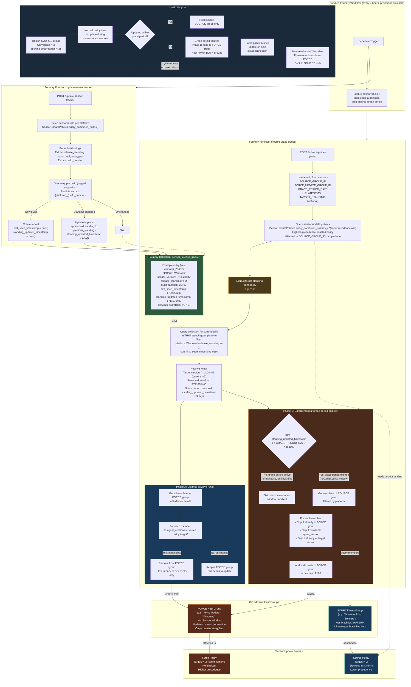

# Sensor Update Enforcer - Architecture

## Overview

This Falcon Foundry app ensures hosts stay up-to-date with the sensor version targeted by their source host group's policy, even if they're only online during business hours when updates are blacked out.

The app is built entirely on Foundry primitives: **Foundry Functions** (Python) for the logic, a **Foundry Collection** for persistent state, a bundled **Foundry Workflow** for scheduling, and a **Foundry UI Page** (React + Vite, the app homepage) that visualizes the collection as a release-standings dashboard. No external infrastructure is required.

## Architecture Diagram

## Foundry Components

| Component | Type | Purpose |
|-----------|------|---------|
| `update-sensor-tracker` | Foundry Function (Python) | Polls sensor builds API, tracks version standings in collection |
| `enforce-grace-period` | Foundry Function (Python) | Manages force-group membership based on grace period |
| `sensor_release_tracker` | Foundry Collection | One record per build: current standing, `standing_updated_timestamp` (grace period anchor), and standing history |
| Sensor Update Enforcer - Scheduled | Foundry Workflow (bundled, provisions on install) | Every 4 hours: tracker, 10-minute sleep, then enforcement |
| Sensor Release Tracker | Foundry UI Page (React + Vite) | App homepage; dashboard of release standings and update history from the collection |

## Configuration and Setup

Environment variables, the policy and host group prerequisites, and the
pre-production checklist live in the [README](README.md#setup-guide).

## Failure Handling

- **Can't read the source policies or the force group:** the run stops before
  changing anything and returns the Falcon API's own status and message.
- **A collection lookup, source-group query, or add/remove batch fails:** that
  step is recorded in `errors`, the rest of the run continues, and the response
  is a 207. Only hosts whose add/remove call succeeded are reported as moved.
- **update-sensor-tracker can't read a record:** that build is skipped and
  reported, never recreated -- recreating it would reset its
  `standing_updated_timestamp` and restart the grace period.
